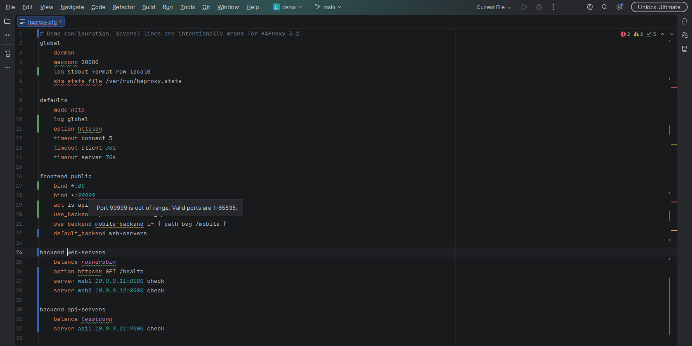
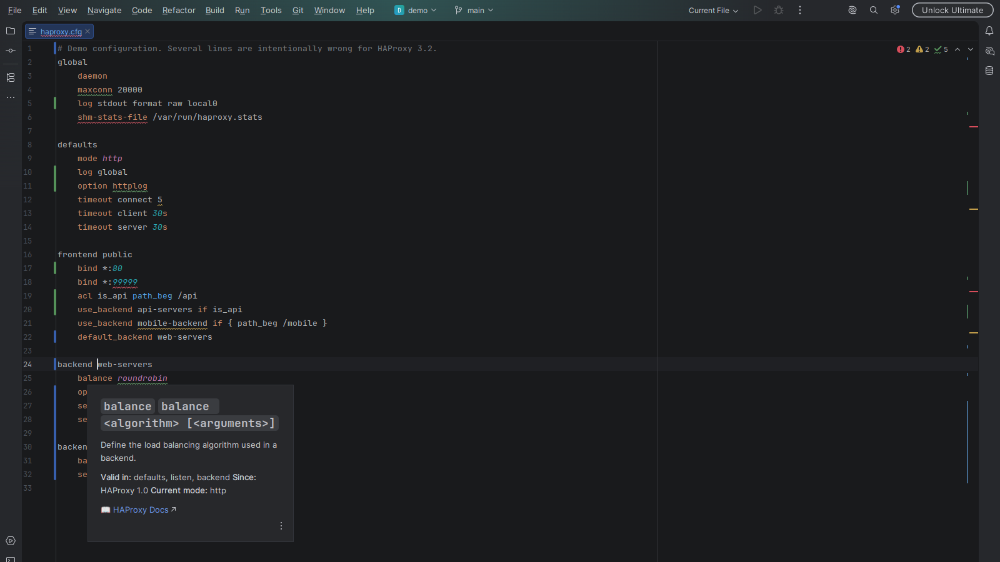
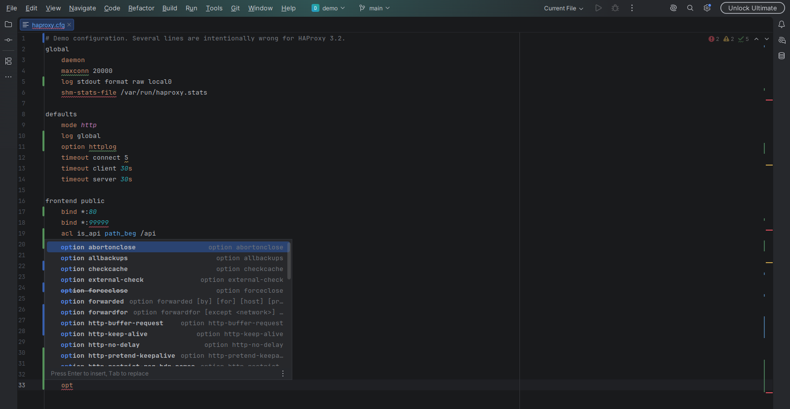
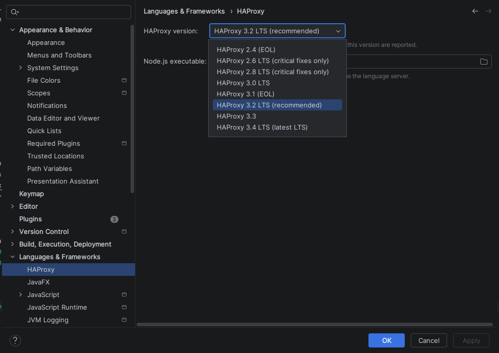

# HAProxy Language Support for JetBrains IDEs

[](https://github.com/JuanTorchia/gmm-haproxy-jetbrains/actions/workflows/build.yml)
[](LICENSE)

**Version-aware HAProxy configuration support for IntelliJ IDEA, PyCharm and other JetBrains IDEs.**
Catch config mistakes while editing instead of when HAProxy refuses to reload.

The plugin runs the same language server as the
[HAProxy Config extension for VS Code](https://marketplace.visualstudio.com/items?itemName=gmm.gmm-haproxy-vscode)
(also on [Open VSX](https://open-vsx.org/extension/gmm/gmm-haproxy-vscode)), so validation rules and
documentation are identical in both editors.

Built and maintained by [Juan Torchia](https://github.com/JuanTorchia) as part of
[GMM Software Solutions](https://gmmhub.net/). Guide: [gmmhub.net/haproxy-config-check](https://gmmhub.net/haproxy-config-check).

## Features

- **Syntax highlighting** for sections, directives, ACLs, addresses, ports and timeouts.
- **Version-aware validation** for HAProxy 2.4 to 3.4: unknown directives, directives in the wrong section,
  out-of-range ports, unitless timeouts, deprecated options and `use_backend` targets that do not exist.
- **Completion** for directives and `option` variants, filtered by section.
- **Hover documentation** with signature, valid sections and the HAProxy version that introduced the directive.
- **Go to definition** and **rename** for backends.







## Requirements

- A JetBrains IDE based on 2026.1 or later that includes the platform LSP support
  (verified on IntelliJ IDEA 2026.1 and 2026.2, and PyCharm 2026.1).
- **Node.js** (current LTS) to run the language server. The plugin uses `node` from `PATH`, or the executable
  set in the settings. Without Node.js, syntax highlighting still works and the IDE shows a warning with a
  shortcut to the settings.

## Settings

*Settings | Languages & Frameworks | HAProxy*

| Setting | Default | Description |
|---|---|---|
| HAProxy version | 3.2 | Version used to decide which directives exist or are deprecated. |
| Node.js executable | empty | Path to `node`. Empty means `node` from `PATH`. |

Changes restart the language server in every open project.



## Which files are HAProxy files

Matched by name, the same rules as the VS Code extension:

- `haproxy.cfg`, `haproxy.conf` and `haproxy*.cfg`
- any `.cfg` or `.conf` inside a directory named `haproxy`

Other `.cfg` and `.conf` files are checked for HAProxy section headers (`global`, `defaults`, `frontend`,
`backend`, `listen`, `userlist`, `peers`, `resolvers`, `mailers`, `ring`, `log-forward`, `program`,
`http-errors`, `cache`, `acme`) at the start of a line within the first 200 lines. A keyword followed by
`=` or `:` (for example `listen = 127.0.0.1:9000` in php-fpm) does not count. Detection only applies to
local files that the IDE treats as plain text, INI, Properties or TextMate, so files that another plugin
claims are left alone.

Files detected by their headers get validation, completion, hover and navigation. Their syntax colors come
from the generic `.cfg`/`.conf` grammar, because the IDE picks TextMate grammars by file name.

## Install

From the JetBrains Marketplace: *Settings | Plugins | Marketplace*, search for **HAProxy Language Support**.

From a release ZIP: download `gmm-haproxy-jetbrains-<version>.zip` from
[GitHub Releases](https://github.com/JuanTorchia/gmm-haproxy-jetbrains/releases), then
*Settings | Plugins | ⚙ | Install Plugin from Disk*.

## Development

Requirements: JDK 21 (Gradle toolchains can provision it).

```bash
./gradlew test          # unit and platform tests
./gradlew buildPlugin   # build/distributions/gmm-haproxy-jetbrains-<version>.zip
./gradlew runIde        # IntelliJ IDEA sandbox that opens demo/
./gradlew runPyCharm    # PyCharm sandbox that opens demo/
./gradlew verifyPlugin  # Plugin Verifier: IDEA 2026.1.4, IDEA 2026.2.2, PyCharm 2026.1.3
```

Each IDE the verifier downloads takes about 3-4 GB once extracted. To reuse IDEs that are already on disk:

```bash
./gradlew verifyPlugin -PverifierLocalIdes=/path/to/idea-2026.1,/path/to/pycharm-2026.1
```

### Bundled language server

`server.js`, the TextMate grammar and the language configuration come from a released
`gmm-haproxy-vscode` VSIX on Open VSX. The version and the SHA-256 of the VSIX are pinned in
`gradle.properties`:

```properties
haproxyServerVersion=0.6.1
haproxyServerSha256=db9bd9fe92709ac5421c3f09b2c485759f1a4f42ffaad0cffd02d6f7e5c5fe8e
```

The build downloads the VSIX once into `build/haproxy-server/`, fails if the checksum differs, and copies the
three files into the plugin. To move to a new release:

1. Publish the VS Code extension release to Open VSX.
2. Compute the checksum:
   ```bash
   curl -sL https://open-vsx.org/api/gmm/gmm-haproxy-vscode/<version>/file/gmm.gmm-haproxy-vscode-<version>.vsix | sha256sum
   ```
3. Update `haproxyServerVersion` and `haproxyServerSha256`, run `./gradlew clean test buildPlugin`, check the
   demo in `./gradlew runIde`, and mention the server version in the change notes in `plugin.xml`.

### Release

1. Update `<change-notes>` in `src/main/resources/META-INF/plugin.xml`.
2. Create a GitHub release with a `vX.Y.Z` tag. The `JetBrains Marketplace Release` workflow builds, verifies,
   signs and publishes that version, then attaches the ZIP to the release. It runs in the
   `jetbrains-marketplace` environment, which needs the `PUBLISH_TOKEN`, `CERTIFICATE_CHAIN`, `PRIVATE_KEY` and
   `PRIVATE_KEY_PASSWORD` secrets.

## License

[MIT](LICENSE)
